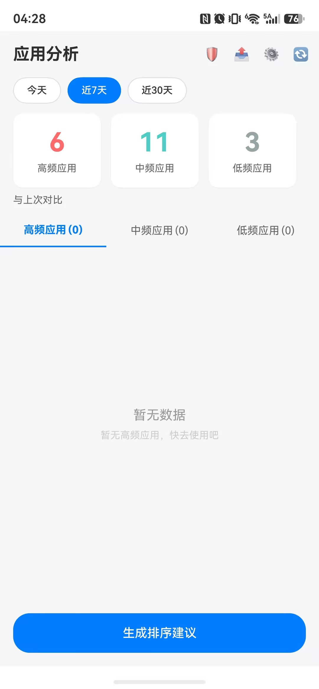
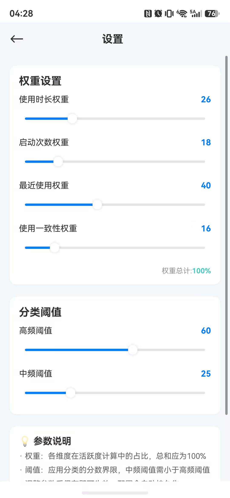

# harmonyos-arkts-demo

> **A complete, working HarmonyOS (ArkTS / ArkUI) reference project — plus a hard-won list of ArkTS gotchas.**
>
> Built and verified on DevEco Studio 6.1, HarmonyOS SDK 6.1.1 (API 24), and a real device (HUAWEI ALN-AL00).
> 5 pages, 4 custom components, 6 service modules, a weighted scoring engine, and on-device persistence.
>
> The original goal — analysing **real** app-usage statistics — turned out to be **impossible for
> third-party apps on HarmonyOS**. The public SDK ships an *empty* `usageStatistics` namespace,
> `bundleManager` has no way to enumerate installed apps, and the required permissions are restricted to
> `SYSTEM` / `ENTERPRISE_NORMAL` apps — declaring them makes the install itself fail (error `9568289`).
> The data layer is therefore mocked; the algorithm is real. See [Why this project stopped](#为什么不做了).
>
> **The most reusable part of this repo is probably the [ArkTS gotchas list](#arkts-踩坑清单)** —
> distilled from fixing 91 real compiler errors after writing the app in plain TypeScript.
> It covers the strict-mode rules (`arkts-no-any-unknown`, `arkts-no-untyped-obj-literals`, …) and the
> ArkUI traps that produce errors with **no file name and no line number**, such as the `_item` collision
> in `ForEach`.
>
> *Documentation below is in Chinese.*

---

一个**能编译、能装、能在真机跑**的 HarmonyOS / ArkTS 完整示例工程。

原本的目标是做「应用使用频率分析」——统计手机上各应用的使用时长与启动次数，加权算出活跃度，
分成高/中/低频并给出桌面整理建议。**这个目标没能达成**，原因见下文《为什么不做了》。

工程本身是完整可用的，可以当作 ArkTS 的参考实现或起手模板。

---

## 截图（真机 HUAWEI ALN-AL00 / API 24）

| 首页 | 设置页 |
|---|---|
|  |  |

> 首页那三张卡片（高频 6 / 中频 11 / 低频 3）是真实计算结果，但下方 Tab 计数显示 `(0)` 且列表为空
> —— 这是一个**已知 bug**，根因是 ArkUI 的 `@Builder` 多参数按值传递，见《[已知遗留](#已知遗留)》。
>
> 设置页的 26 / 18 / 40 / 16 是改过并持久化后重新打开的值，总计正好 100% —— 权重归一化与落盘均正常。

## 环境

| 项 | 版本 |
|---|---|
| DevEco Studio | 6.1 |
| HarmonyOS SDK | 6.1.1（API 24） |
| Node（IDE 自带） | v18.20.1 |
| 验证真机 | HUAWEI ALN-AL00，API 24 |

## 跑起来

**只看界面（推荐，零配置）**

打开 `entry/src/main/ets/pages/Index.ets`，点右侧 `Previewer`。不需要签名、不需要华为账号。

**装到真机**

1. `File > Project Structure > Signing Configs` → 勾 `Automatically generate signature`
   （需华为账号，且**账号必须完成实名认证**，否则会报「未实名用户在使用自动签名前需签署协议」）
2. 手机开发者模式 + USB 调试，数据线选「传输文件」
3. 选中设备，`Shift+F10`

**命令行构建**

```powershell
$env:DEVECO_SDK_HOME = "<DevEco 安装目录>\sdk"
node "<DevEco 安装目录>\tools\hvigor\bin\hvigorw.js" assembleHap --mode module -p module=entry@default -p product=default -p buildMode=debug
```

`DEVECO_SDK_HOME` 必须手动带——IDE 运行时会自己注入，命令行不会。改完配置先 `--stop-daemon`，daemon 会缓存旧环境。

## 工程结构

```
entry/src/main/ets/
├── entryability/EntryAbility.ets    应用入口（UIAbility）
├── model/
│   ├── AppUsageInfo.ets             数据模型 + 枚举
│   ├── SortResult.ets               分类结果
│   └── Types.ets                    共享 interface 集中声明
├── service/
│   ├── UsageAnalyzer.ets            四维加权评分引擎 + 分类
│   ├── AppDataService.ets           缓存 / 趋势 / 报告生成
│   ├── PreferenceService.ets        配置持久化（@ohos.data.preferences）
│   ├── HistoryService.ets           历史快照与环比
│   ├── LimitService.ets             使用限额
│   └── ShareService.ets             系统分享 + 剪贴板
├── components/                      AppCard / StatCard / TrendChart / SortSuggestion
├── pages/                           Index / AppDetail / Settings / SharePage / LimitPage
└── utils/DateUtil.ets
```

### 评分算法

活跃度 = 时长×w1 + 启动次数×w2 + 最近使用×w3 + 使用一致性×w4

四项权重与两个分类阈值（高频/中频）都可在设置页调整并持久化。
权重内部按占比归一化，所以填 60/30/20/10 与 50/25/17/8 等价。

> ⚠️ **数据是模拟的。** `UsageAnalyzer.fetchInstalledApps()` 与 `fetchUsageStats()` 返回写死的
> 20 个应用和确定性伪随机数值。**算法是真的**，只是喂给它的输入是假的。这两个方法的返回类型
> （`AppMeta[]` / `UsageStat[]`）已刻意对齐系统 API 的字段命名，若将来拿到权限只需替换这两处。

---

## 为什么不做了

真实使用数据拿不到，而且**不是姿势不对，是路封死**。三条互相独立的证据：

**1. 公开 SDK 里根本没有这个 API**

```ts
// @ohos.resourceschedule.usageStatistics.d.ts —— 全文 34 行
declare namespace usageStatistics {
}
export default usageStatistics;
```

namespace 是空的。`bundleManager` 有 2424 行、25 个函数，但没有 `getAllApplicationInfo` /
`getAllBundleInfo`，**无法枚举已安装应用**。

**2. 权限表按身份锁死**

`sdk/.../toolchains/lib/PermissionDefinitions.json`（735 条权限）：

| 权限 | availableLevel | availableType | provisionEnable |
|---|---|---|---|
| `BUNDLE_ACTIVE_INFO` | system_basic | **SYSTEM** | true |
| `GET_BUNDLE_INFO_PRIVILEGED` | system_basic | **ENTERPRISE_NORMAL** | true |

`provisionEnable: true` 说明技术上可经签名 ACL 授予，但 `availableType` 决定了只发给
**系统应用**和**企业应用**。个人开发者账号申请不到。

**3. 安装阶段直接驳回**

不是"装上后调不通"，是根本装不上：

```
install failed due to grant request permissions failed.
PermissionName: ohos.permission.BUNDLE_ACTIVE_INFO
code: 9568289
```

系统在装包时逐条校验 `requestPermissions`，有一条授不了就整包失败。

**补充**：真机调试不改变这一点。USB 调试给的是安装、日志、断点，不提升权限等级。
华为自己的「小艺建议」能做同类功能，正因为它是系统应用。

---

## ArkTS 踩坑清单

ArkTS 是**刻意收紧**的 TypeScript 方言。本工程初版按普通 TS 写，产生 **91 个编译错误**，
全部归到以下几类。这份清单可能比工程本身更有参考价值。

| 禁止的写法 | 规则名 | 改法 |
|---|---|---|
| 匿名对象字面量 `return { a: 1 }` | `arkts-no-untyped-obj-literals` | 先声明 interface，再 `const x: T = {...}` |
| 对象字面量当类型 `): { a: number }` | `arkts-no-obj-literals-as-types` | 用具名 interface |
| `any` / `unknown` | `arkts-no-any-unknown` | 显式类型；`JSON.parse(s) as T` |
| 解构声明 / 解构入参 | `arkts-no-destruct-decls` / `-params` | 改属性访问 |
| `throw error`（非 Error） | `arkts-limited-throw` | `throw new Error(...)` |
| 静态方法内 `this.foo()` | `arkts-no-standalone-this` | 用类名 `DateUtil.foo()` |
| 箭头函数返回类型推断 | `arkts-no-implicit-return-types` | `(s: T): number => ...` |
| `Math.max(...arr)` | 展开支持受限 | 显式循环求最值 |

### ArkUI 特有

- **`build()` 里不能声明 `const`** → 报 `Only UI component syntax can be written here`，
  把计算抽成类方法，UI 里调 `this.getXxx()`
- **`Resource` 没有 `.value`** → `$r('app.string.x').value` 报错，也不能拼进模板字符串，
  拆成两个 `Text` 放进 `Row`
- **`@Prop height` 与组件自带 `height` 冲突** → 改名（本工程用 `chartHeight`）
- 参数用 `ResourceStr`（`string | Resource`）才能同时接字面量与 `$r()`；颜色用 `ResourceColor`
- `Column` 没有 `borderBottomWidth` → `.border({ width: { bottom: n }, color: { bottom: c } })`
- **`ForEach` 的参数别取名 `_item`** → 转译器给同一 `build()` 内每个 `ForEach` 生成的临时变量
  就叫 `_item`，会撞出 `Identifier '_item' has already been declared`。
  **这个报错不指文件、不指行号**，只能全局搜 `ForEach` 定位
- **Ability 不是组件** → 必须 `export default class EntryAbility extends UIAbility`，
  写成 `@Entry @Component struct` 会报 `must have at least and at most one 'build' method`
- **`@Builder` 多参数是按值传递，不响应状态变化** → 只有传**单个对象参数**时才按引用、才会跟随 `@State` 刷新。
  传多个参数时实参在首次渲染就被定死。**编译期零警告**，运行时表现为"数据明明有、界面就是不更新"。
  本仓库首页 Tab 计数恒为 0 就是这个原因（见《[已知遗留](#已知遗留)》），是清单里最难自己发现的一条

---

## 已知遗留

### 🔴 首页 Tab 计数为 0、列表显示"暂无数据"（未修）

见上方首页截图：三张统计卡片正确显示 6 / 11 / 3，但 Tab 标题是 `(0)`、列表区空。
**同一份数据在同一屏上显示不一致。**

根因不是数据问题，是 **ArkUI 的 `@Builder` 传参语义**：

```ts
Tabs(...) {
  TabContent() {
    this.AppList(this.sortResult.highFrequencyApps, ...)   // 多参数 → 按值传递
  }
  .tabBar(this.TabBuilder($r('...'), 0, this.sortResult.highFrequencyApps.length))
}
```

`@Builder` **只有在接收单个对象参数时才按引用传递、才会跟随状态刷新**。
传多个参数（或值类型）时是**按值传递**，在首次渲染那一刻就把实参定死了。
首次渲染时 `sortResult` 还是空的 `new SortResult()`，于是 Tab 永远是 0、列表永远空。

而三张统计卡片直接写在 `build()` 里、不经过 `@Builder`，所以能正常响应 `@State` 变化。

**修法**：把 `AppList` / `TabBuilder` 的入参合并成单个 interface 对象再传。

> 这个坑很典型：ArkUI 的 `@Builder` 看起来像普通函数，但它的参数传递语义决定了 UI 是否响应式。
> 编译期不会有任何警告，只在运行时表现为"数据明明有、界面就是不更新"。

### 其他

- 设置页权重：落盘存原值、算分用归一化占比，重开后显示会按比例缩放到总和 100；
  `Math.round` 后可能是 99 或 101，导致"权重总计"误显示为红色
- `router.pushUrl` 已废弃（7 处 warning），未迁移到 `pushNamedRoute`

## 许可

MIT
